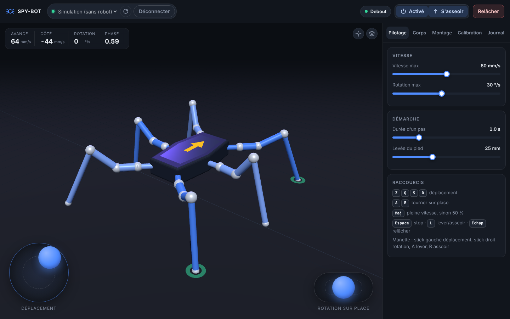

# SPY-BOT

Hexapode 6 pattes piloté par cinématique inverse, sur ESP32, avec une interface PC en 3D.

- **Robot** : un ESP32 sous MicroPython et 2 cartes PCA9685 (18 servos). Il calcule lui-même l'IK et la démarche.
- **PC** : une page web locale qui affiche le robot en 3D et permet de l'alimenter, le lever, le piloter (vitesse, pas de côté, rotation sur place), bouger le corps et calibrer les servos.

```
 navigateur  ⇄  pc/server.py  ⇄  USB série  ⇄  ESP32 (main.py)  ⇄  I²C  ⇄  2 × PCA9685  →  18 servos
```

L'IK tourne sur l'ESP32 et non sur le PC : la marche reste fluide même si la liaison a des à-coups, et le robot s'arrête tout seul (pieds au sol) s'il ne reçoit plus d'ordre pendant 0,5 s.

## Matériel et câblage

Géométrie reprise de [SmallpTsai/hexapod-v2-7697](https://github.com/SmallpTsai/hexapod-v2-7697), la carte LinkIt 7697 étant remplacée par un ESP32.

| ESP32 | PCA9685 (les deux cartes) |
| --- | --- |
| GPIO21 | SDA |
| GPIO22 | SCL |
| 3V3 | VCC |
| GND | GND (commun avec l'alimentation des servos) |

1ʳᵉ carte en `0x40` (pattes avant et milieu gauche), 2ᵉ carte en `0x41` (pont A0 soudé : milieu droite et pattes arrière). Les servos sont alimentés séparément (5-6 V, plusieurs ampères), jamais par l'ESP32.

| Patte | Carte | Canaux coxa / fémur / tibia |
| --- | --- | --- |
| Avant droite (RF) | 0x40 | 5 / 6 / 7 |
| Avant gauche (LF) | 0x40 | 2 / 3 / 4 |
| Milieu gauche (LM) | 0x40 | 8 / 9 / 10 |
| Milieu droite (RM) | 0x41 | 2 / 3 / 4 |
| Arrière gauche (LR) | 0x41 | 5 / 6 / 7 |
| Arrière droite (RR) | 0x41 | 8 / 9 / 10 |

Autre câblage ou autres broches : `WIRING` dans `hexapod/config.py`, `sda`/`scl` dans `PCA9685Driver` (`hexapod/servo.py`).

### Dimensions

Toutes les longueurs sont dans `DIMENSIONS`, en haut de `hexapod/config.py` (en mm ; actuellement les pièces de hexapod-v2-7697 imprimées à 150 %, avec la coxa, le fémur et le tibia mesurés sur le robot). Si tes pièces sont agrandies, change uniquement ces valeurs : la posture debout, la longueur de pas et la vue 3D s'adaptent toutes seules. Mesure d'axe à axe :

- `root_to_coxa` : bord du châssis → axe du servo de coxa
- `coxa` : axe coxa → axe fémur
- `femur` : axe fémur → axe tibia
- `tibia` : axe tibia → bout du pied
- `mount_*` : position des fixations des pattes par rapport au centre du châssis

## Installation

Sur le PC (Python 3.9 ou plus récent) :

```bash
pip install -r requirements.txt
```

### 1. Installer MicroPython sur l'ESP32 (une seule fois)

Télécharge le firmware « ESP32 / Generic » sur <https://micropython.org/download/ESP32_GENERIC/> (fichier `.bin`), puis, avec le bon port (`COM3` sous Windows, `/dev/ttyUSB0` sous Linux, `/dev/cu.usbserial-…` sous macOS) :

```bash
esptool.py --chip esp32 --port COM3 erase_flash
esptool.py --chip esp32 --port COM3 --baud 460800 write_flash -z 0x1000 ESP32_GENERIC-xxxx.bin
```

### 2. Copier le programme du robot

Depuis la racine du dépôt :

```bash
mpremote connect COM3 fs cp -r hexapod : + fs cp main.py : + reset
```

À refaire après chaque modification de `hexapod/` ou `main.py` (par exemple après avoir changé `DIMENSIONS`). Au démarrage l'ESP32 lance `main.py`, et les servos restent relâchés.

### 3. Lancer l'interface

Ferme `mpremote` (un seul programme peut ouvrir le port série), puis :

```bash
python -m pc.server
```

Ouvre <http://localhost:8000>, choisis le port de l'ESP32 et clique sur **Connecter**. L'option **Simulation** fait tourner exactement le même code sans robot, pour essayer l'interface.

Pour piloter depuis un téléphone sur le même Wi-Fi que le PC, lance `python -m pc.server --lan` et ouvre l'adresse affichée (`http://192.168.x.x:8000`) sur le téléphone. Attention : toute personne sur ce Wi-Fi peut alors piloter le robot. Le téléphone tenu en paysage passe en mode pilote (3D et joysticks en plein écran), et **Ajouter à l'écran d'accueil** l'installe comme une application.

Si le câble USB saute, le serveur rouvre le port tout seul dès que l'ESP32 revient ; le temps de réponse du robot s'affiche à côté du bouton **Connecter**.

## Montage et premier essai

Le guide pas à pas est dans [docs/MONTAGE.md](docs/MONTAGE.md) : assemblage, câblage, quel servo sur quel canal, vérification servo par servo, centrage des palonniers et calibration. L'onglet **Montage** de l'interface montre le câblage sur le modèle 3D.

## Pilotage



- **Joystick gauche** : avancer, reculer et se déplacer de côté, avec une vitesse proportionnelle à l'inclinaison.
- **Joystick droit** : tourner sur place.
- Clavier : Z/Q/S/D pour se déplacer, A/E pour tourner, Maj pour aller à pleine vitesse, Espace pour s'arrêter, L pour se lever ou s'asseoir, Échap pour relâcher les servos.
- Manette (Xbox, PlayStation...) : stick gauche pour se déplacer, stick droit pour tourner, A pour se lever, B pour s'asseoir.

Les onglets règlent la vitesse maximale (avec les préréglages **Lent**, **Normal** et **Rapide**), la démarche, la position et l'inclinaison du corps, le câblage et la calibration. Le journal montre les échanges avec le robot et permet de taper une commande à la main.

- **Démarrage en douceur** : à la mise sous tension, les pattes s'activent l'une après l'autre (moins d'appel de courant), puis le robot se lève.
- **Servos en butée** : un servo qui arrive au bout de sa course passe en rouge dans la 3D, avec son étiquette carte · canal.
- **Traces des pieds** (bouton en haut à droite de la vue) : le sol défile sous le robot et chaque pied y laisse sa trace, verte au sol, bleue en l'air. Un pied qui glisse laisse un trait au lieu d'un point. Le défilement est estimé d'après les consignes, sans capteur.
- **Animations** : révérence, danse, pompes... et un éditeur pour créer les tiennes à partir des poses de l'onglet **Corps**. Elles sont enregistrées dans le navigateur.
- **Servo à l'envers** : si une patte réelle part dans le sens opposé à la 3D pendant **Tester ce servo**, **Inverser le sens** corrige ce servo (enregistré avec les trims).
- **Calibration** : **Exporter** télécharge les trims dans un fichier, **Importer** les recharge (par exemple après avoir reflashé l'ESP32), puis **Enregistrer** les garde dans le robot.

## Organisation du code

| Fichier | Rôle |
| --- | --- |
| `hexapod/leg_ik.py` | IK et FK d'une patte 3 DDL (solution « genou en haut »). |
| `hexapod/body_ik.py` | IK du corps : translation et roulis/tangage/lacet, pieds fixes au sol. |
| `hexapod/gait.py` | Démarche tripode pilotée par `vx`, `vy`, `yaw_rate`, arrêt toujours pieds posés. |
| `hexapod/servo.py` | Angle IK → angle servo (milieu, sens, trim, butées) et pilote PCA9685 pour MicroPython. |
| `hexapod/controller.py` | États du robot (relâché, assis, debout, calibration) et protocole texte avec le PC. |
| `hexapod/config.py` | Dimensions, posture debout, câblage. |
| `main.py` | Boucle de l'ESP32 à 50 Hz. |
| `pc/server.py` | Serveur local de l'interface PC, entre le navigateur et le port série. |
| `pc/web/` | Page web : vue 3D (three.js), joysticks, montage, calibration, animations (`anim.js`). |
| `docs/MONTAGE.md` | Guide de montage et de câblage. |
| `sim/simulate.py` | Ancienne simulation matplotlib (optionnelle). |

Le code de `hexapod/` n'utilise que ce qui existe aussi dans MicroPython : il tourne pareil sur l'ESP32 et sur le PC.

## Tests

```bash
python -m unittest -v                     # PC
micropython tests/micropython_smoke.py    # même code sous MicroPython
```

## Protocole série

Une commande par ligne à 115200 bauds, documentée en tête de `hexapod/controller.py` : `POWER 1|0`, `STAND`, `SIT`, `MOVE vx vy yaw`, `POSE x y z roll pitch yaw`, `GAIT période hauteur`, `CAL`, `TEST patte articulation`, `TRIM patte articulation degrés`, `INVERT patte articulation 1|0`, `SAVE`, `GETCAL`, `GEOM`. Le robot renvoie `OK …`, `ERR …` et une ligne de télémétrie `T …` 20 fois par seconde.
