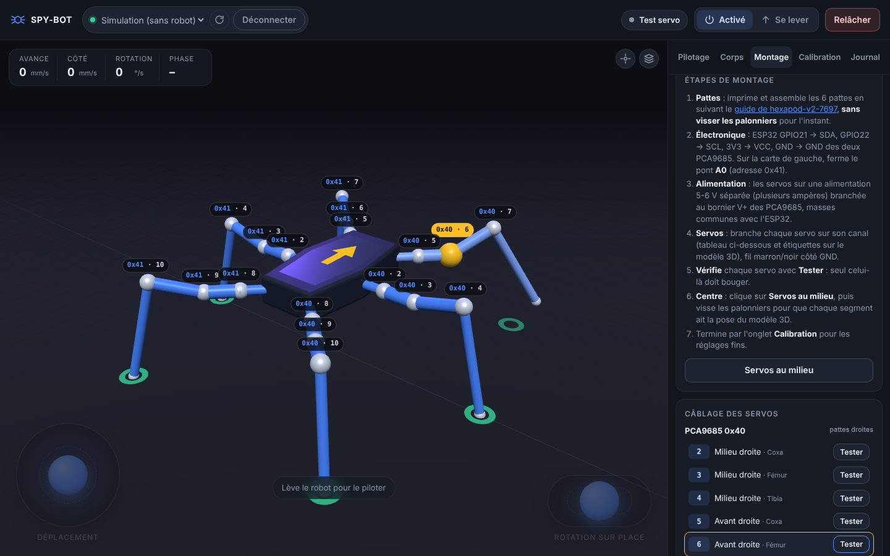

# Guide de montage

Ce guide part du hexapode [SmallpTsai/hexapod-v2-7697](https://github.com/SmallpTsai/hexapod-v2-7697) (pièces imprimées, servos MG92B) avec un ESP32 à la place de la carte LinkIt 7697. L'onglet **Montage** de l'interface PC montre la même chose en 3D : chaque servo y porte l'étiquette de sa carte et de son canal, et le bouton **Tester** le fait bouger seul.



## Matériel

| Quantité | Pièce |
| --- | --- |
| 1 | ESP32 (DevKit, 38 broches ou équivalent) |
| 2 | Cartes PCA9685 16 canaux |
| 18 | Servos MG92B (ou MG90S, mêmes dimensions) |
| 1 | Alimentation des servos 5-6 V, 5 A ou plus (régulateur BEC, ou batterie LiPo 2S + abaisseur) |
| 1 jeu | Pièces imprimées de hexapod-v2-7697 (agrandies ou non) |
| | Vis M2 × 30 mm et écrous, fils Dupont femelle-femelle |

## 1. Assembler les pattes (sans les palonniers)

Suis le [guide des pattes de hexapod-v2-7697](https://github.com/SmallpTsai/hexapod-v2-7697/blob/master/mechanism/LEG.md) et sa [vidéo](https://youtu.be/oaAE5fC09KQ). **Ne visse pas encore les palonniers** : il faut d'abord mettre chaque servo au milieu de sa course (étape 5), sinon les pattes seront décalées.

Chaque patte a trois servos :

- **coxa** : à la fixation sur le châssis, fait pivoter la patte vers l'avant ou l'arrière ;
- **fémur** : lève et abaisse la cuisse ;
- **tibia** : plie le bas de la patte.

Si tu as agrandi des pièces, mesure ensuite les longueurs d'axe à axe et reporte-les dans `DIMENSIONS` (`hexapod/config.py`).

## 2. Câbler l'électronique

```
              ┌────────────┐        I²C (4 fils)        ┌──────────────────┐
  USB PC ─────┤   ESP32    ├─ GPIO21 ─ SDA ─┬───────────┤ PCA9685 0x40     │  pattes DROITES
              │            ├─ GPIO22 ─ SCL ─┼─┬─────────┤ (A0 ouvert)      │
              │            ├─ 3V3 ─── VCC ──┼─┼─┬───────┤                  │
              │            ├─ GND ─── GND ──┼─┼─┼─┬─────┤                  │
              └────────────┘                │ │ │ │     └──────────────────┘
                                            │ │ │ │     ┌──────────────────┐
                                            └─┴─┴─┴─────┤ PCA9685 0x41     │  pattes GAUCHES
                                                        │ (pont A0 soudé)  │
  Alim. servos 5-6 V ── V+ / GND (borniers des deux cartes, GND commun avec l'ESP32)
```

- Les deux PCA9685 partagent le même bus I²C (en chaîne ou en étoile).
- **Adresse** : laisse la carte des pattes droites telle quelle (0x40) ; sur celle des pattes gauches, **soude le pont A0** pour obtenir 0x41.
- **Alimentation** : les servos ne doivent jamais être alimentés par l'ESP32. Branche l'alimentation 5-6 V sur le bornier V+ / GND des PCA9685, et relie sa masse à celle de l'ESP32.

## 3. Brancher les servos

Fil marron (ou noir) côté **GND**, rouge au milieu, orange (ou jaune) côté **PWM**.

| Patte | Carte | Coxa | Fémur | Tibia |
| --- | --- | --- | --- | --- |
| Avant droite (RF) | 0x40 | canal 5 | canal 6 | canal 7 |
| Milieu droite (RM) | 0x40 | canal 2 | canal 3 | canal 4 |
| Arrière droite (RR) | 0x40 | canal 8 | canal 9 | canal 10 |
| Avant gauche (LF) | 0x41 | canal 5 | canal 6 | canal 7 |
| Milieu gauche (LM) | 0x41 | canal 2 | canal 3 | canal 4 |
| Arrière gauche (LR) | 0x41 | canal 8 | canal 9 | canal 10 |

Les canaux 0, 1 et 11 à 15 restent libres. La droite et la gauche se comprennent robot vu de dessus, avant vers le haut. Ce câblage est celui de hexapod-v2-7697 ; pour un autre, modifie `WIRING` dans `hexapod/config.py`.

## 4. Installer le logiciel et vérifier le câblage

1. Installe MicroPython et le programme sur l'ESP32 (voir le [README](../README.md#installation)).
2. Lance `python -m pc.server`, ouvre <http://localhost:8000> et connecte-toi à l'ESP32.
3. Onglet **Montage** : clique sur **Tester** pour chaque servo. Seul ce servo doit osciller pendant 3 secondes, et le modèle 3D montre lequel doit bouger. Si un autre bouge, inverse les deux prises.

## 5. Mettre en pose de montage et visser les palonniers

1. Clique sur **Pose de montage** : les 18 servos prennent la pose de calibration et la tiennent tant qu'ils sont alimentés.
2. Sans les faire tourner, enfonce chaque palonnier dans la position la plus proche de cette pose, puis visse :
   - coxa dans l'axe de sa fixation, perpendiculaire au bord du châssis ;
   - fémur à l'horizontale, parallèle au sol (une équerre ou un niveau aide) ;
   - tibia vertical, à angle droit avec le fémur.

Les cannelures du palonnier ne permettent pas un réglage exact : le reste se fait par logiciel, à l'étape suivante.

## 6. Calibrer

Onglet **Calibration**, robot posé sur une boîte, pattes dans le vide :

1. **Pose de calibration** (la même pose qu'à l'étape 5).
2. Pour chaque patte, ajuste les trims coxa, fémur et tibia (boutons − / + par pas de 0,5°) jusqu'à ce que la patte réelle ait la pose du modèle 3D.
3. **Enregistrer** : les trims sont gardés dans l'ESP32 (`calib.json`) et rechargés à chaque démarrage.

Si un servo part dans le mauvais sens quand le robot se lève, change son `direction` (+1 ou −1) dans `default_config()` (`hexapod/config.py`) puis recopie les fichiers sur l'ESP32.

## 7. Premier lever

Toujours sur la boîte : **Se lever** (les servos s'alimentent tout seuls). Le même bouton devient **S'asseoir**, et **Relâcher** coupe les servos. Si tout est cohérent, pose le robot au sol, relève-le et pilote-le avec les joysticks, le clavier ou une manette.


